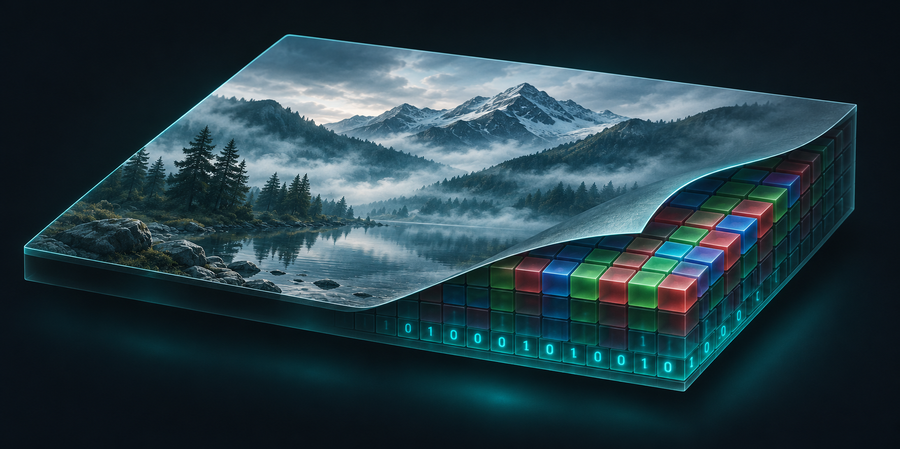

<div align="center">

**Русский** · [English](README.en.md)


**Секретный текст. Обычная картинка.**

Скрывайте сообщения в пикселях и извлекайте их одной командой.


[Быстрый старт](#быстрый-старт) · [Как это работает](#как-это-работает) · [Команды](#команды) · [Проверка](#проверка)

</div>

---

## Текст под поверхностью

**IMAGESTEG** — небольшая утилита на Python для LSB-стеганографии. Она записывает текст в младшие биты цветовых каналов изображения: изменения значений минимальны и обычно незаметны глазу. Подходит для экспериментов с изображениями и изучения скрытой передачи данных.

| Возможность | Что внутри |
| :--- | :--- |
| Текст в UTF-8 | Кириллица, латиница и эмодзи |
| Работа с RGB и RGBA | Альфа-канал сохраняется; другие режимы конвертируются в RGB |
| Сохранение в PNG | Без потери битов скрытого сообщения |
| Отчёт в терминале | Размер картинки, объём текста и заполнение контейнера |

## Быстрый старт

Нужен **Python 3.13+**. Выполняйте команды из папки проекта.

```bash
python -m venv .venv
```

Активируйте окружение:

```bash
# Linux / macOS
source .venv/bin/activate
```

```powershell
# Windows PowerShell
.venv\Scripts\Activate.ps1
```

Установите зависимость:

```bash
python -m pip install "Pillow>=11.2.1"
```

**01 · Спрячьте сообщение**

Положите исходное изображение `my_photo.png` в папку проекта и выполните:

```bash
python imagesteg.py --input my_photo.png --output hidden_message.png --message "Привет! Я тайное послание."
```

**02 · Прочитайте его обратно**

```bash
python imagesteg.py --decode --input hidden_message.png
```

<details>
<summary>Используете uv?</summary>

Установите зависимости из файла блокировки и запускайте команды через `uv run`:

```bash
uv sync --locked
uv run python imagesteg.py --input my_photo.png --output hidden_message.png --message "Привет! Я тайное послание."
uv run python imagesteg.py --decode --input hidden_message.png
```

</details>

## Как это работает



Каждый пиксель содержит каналы **R**, **G** и **B**. Утилита заменяет последний бит каждого из них одним битом сообщения. Значение канала меняется максимум на единицу; прозрачность не затрагивается.

```text
Текст → байты UTF-8 → биты → младшие биты RGB → PNG
                                                │
Текст ← декодирование UTF-8 ← чтение младших битов ┘
```

Например, запись бита `1` в канал со значением `11001010` даст `11001011`: **202 → 203**.

В конце текста записывается нулевой байт — признак завершения сообщения. Декодер читает младшие биты в том же порядке и останавливается на этом маркере.

**Вместимость** зависит от числа пикселей:

```text
максимум байт текста = floor(ширина × высота × 3 / 8) − 1
```

Один байт зарезервирован под маркер завершения. Например, изображение **100 × 100 px** вмещает до **3 749 байт** текста. Это число байт UTF-8, а не символов: кириллица и эмодзи занимают больше одного байта.

## Команды

| Аргумент | Назначение |
| :--- | :--- |
| `--input` | Путь к исходной картинке или PNG со скрытым текстом; обязателен |
| `--output` | Путь к результату с расширением `.png`; обязателен при кодировании |
| `--message` | Текст для записи; обязателен при кодировании |
| `--decode` | Извлечь сообщение вместо записи |
| `--help` | Открыть справку и примеры |

### Что покажет терминал

Пример отчёта для картинки 100 × 100 px и сообщения `Привет`:

```text
+--- IMAGESTEG / МИССИЯ ВЫПОЛНЕНА ---+
  Контейнер: 100 x 100 px
  Спрятано: 12 байт текста
  Заполнение: [........................] 0.3%
  Файл: hidden_message.png
  Пиксели хранят ваш секрет.
+--------------------------------------------+
```

В интерактивном терминале рамка подсвечивается голубым; при перенаправлении вывода ANSI-коды отключаются. Ошибки выводятся в `stderr`, код завершения — `1`.

## Что учитывать

> **Стеганография скрывает присутствие текста, но не шифрует его.** Любой, кто знает способ записи, может извлечь сообщение. Парольная защита в текущей версии не реализована.

- Сохраняйте и передавайте результат как **исходный PNG-файл**. JPEG, изменение размера и обработка картинки могут разрушить сообщение; сервисы обмена изображениями могут пересжимать файлы.
- Текст не должен содержать нулевой символ (`\0`): он используется как маркер завершения.
- Наличие маркера не подтверждает подлинность сообщения. Обычная картинка иногда может случайно распознаться как текст.
- Объём текста проверяется до записи: если изображение слишком маленькое, утилита сообщит об ошибке.

## Дисклеймер

> Проект предназначен для обучения и исследовательских экспериментов. Используйте его только в законных целях и с файлами, которые вы вправе обрабатывать и передавать. Ответственность за способ использования утилиты и передаваемые данные лежит на пользователе.
>
> Утилита предоставляется «как есть», без гарантий сохранности данных, конфиденциальности или незаметности скрытого сообщения. Не используйте её как единственный способ защиты чувствительной информации и сохраняйте резервные копии исходных файлов.

## Проверка

```bash
python -m unittest discover -s tests
```

Тесты проверяют запись и чтение текста, сохранность альфа-канала, обработку некорректных входных данных и изображений без сообщения.

<details>
<summary>Идеи для развития</summary>

- Шифрование сообщения с паролем перед встраиванием.
- Заголовок с длиной данных и проверкой целостности.
- Исследование других способов размещения битов в изображении.

Это возможные направления развития, а не функции текущей версии.

</details>

---

<div align="center">
<sub>IMAGESTEG · Python / Pillow / LSB · Пиксели хранят ваш секрет.</sub>
</div>
